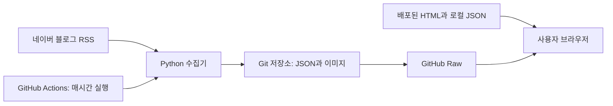

# 다함재가복지센터 웹사이트

방문요양을 알아보는 보호자가 서비스와 이용 절차를 확인하고 전화·네이버 톡톡 상담으로 연결되는 반응형 웹사이트입니다. **별도 백엔드 없이 블로그 소식을 자동으로 갱신하는 운영 구조**를 구현했습니다.

- **프로젝트 형태:** 개인 프로젝트
- **담당 범위:** 기획, 화면 구성, 프런트엔드 구현, 블로그 갱신 자동화, 배포 및 검색엔진 등록
- **사이트:** [dahamcare.kr](https://dahamcare.kr) — 기존 운영 도메인. 현재 가용성은 별도 확인이 필요합니다.
- **핵심 코드:** [화면](dist/index.html) · [사용자 인터랙션](dist/script.js) · [RSS 수집기](scripts/update_blog.py) · [자동 갱신 워크플로](.github/workflows/update-blog.yml)

## 프로젝트의 목적

센터 정보와 블로그에 흩어진 이용 안내를 한 페이지로 정리하고, 보호자가 자신의 상황에 맞는 상담 준비 내용을 찾도록 구성했습니다. 콘텐츠 변경 때마다 홈페이지를 수정하는 부담을 줄이기 위해 최신 블로그 게시글 3개를 자동 수집합니다.

## 주요 기능

| 기능 | 구현 내용 |
| --- | --- |
| 이용 안내 | 장기요양 등급 유무에 따른 안내 전환, FAQ 펼침 |
| 상담 연결 | 전화·네이버 톡톡 바로가기, 모바일 하단 고정 상담 버튼 |
| 위치 안내 | 지도 임베드, 주소 복사와 성공·실패 알림 |
| 블로그 소식 | RSS에서 최신 3개 글 수집, 이미지 저장, 페이지에서 주기적으로 갱신 |
| 접근성 고려 | 본문 바로가기, 키보드 포커스 표시, 선택 상태 전달, 움직임 줄이기 지원 |
| 검색 노출 준비 | 메타데이터, 구조화 데이터, robots.txt, sitemap.xml |

## 기술 스택과 선택 이유

| 기술 | 사용 목적과 선택 이유 |
| --- | --- |
| HTML / CSS / JavaScript | 안내 중심의 단일 페이지를 빌드 과정과 프레임워크 의존성 없이 제공 |
| Python 표준 라이브러리 | 별도 패키지 설치 없이 RSS 파싱·이미지 다운로드·JSON 저장 |
| GitHub Actions | 매시간 RSS 확인과 변경 데이터 커밋 자동화 |
| GitHub Raw / JSON | 공개 소식 데이터를 웹사이트 배포와 분리하여 제공 |
| Caddy / Mac mini | 기존 배포 기록에 기재된 정적 파일 운영 환경 |

## 동작 구조



최초에는 HTML에 포함된 소식을 표시하고, 로컬 JSON과 원격 JSON을 순서대로 읽습니다. 이후 15분마다 원격 데이터를 확인합니다. 외부 요청이 실패해도 마지막으로 표시된 카드를 유지합니다.

## 문제와 해결 방식

### 1. 소식 변경 때마다 정적 사이트를 재배포해야 하는 문제

콘텐츠와 화면 배포를 분리했습니다. Python 수집기가 제목·날짜·링크·대표 이미지를 저장하고, Actions가 변경 사항을 커밋합니다. 브라우저는 공개 JSON을 읽으므로 새 소식 반영에 홈페이지 재배포가 필요하지 않습니다. 대신 GitHub Raw의 가용성과 캐시에 영향을 받는다는 제약이 있습니다.

### 2. 외부 RSS나 이미지 요청 실패로 화면이 비는 문제

수집기는 필요한 다운로드를 먼저 완료한 뒤 JSON을 임시 파일에서 교체합니다. 브라우저에서는 데이터 검증과 카드 생성을 마친 후 화면을 교체하고, 오류가 발생하면 기존 카드를 유지합니다. 단, 이미지와 JSON 전체를 하나의 트랜잭션으로 교체하는 구조는 아닙니다.

### 3. 외부 데이터 표시와 키보드 탐색의 안정성

게시글 URL과 이미지 파일명을 허용된 형식으로 제한하고, 제목은 `textContent`로 표시합니다. 카드 안에 키보드 포커스가 있으면 자동 교체를 건너뛰어 탐색 중인 링크가 사라지는 일을 방지합니다.

## 설계에서 얻은 점

- 안내 중심 서비스는 프레임워크 없이도 구현할 수 있으며, 기능 규모에 맞춘 기술 선택이 유지보수 부담을 줄입니다.
- 정적 사이트에서도 콘텐츠 갱신 주기를 화면 배포 주기와 분리할 수 있습니다.
- 외부 데이터를 다룰 때 정상 응답뿐 아니라 검증 실패·네트워크 실패·기존 데이터 유지 경로도 설계해야 합니다.
- 배포 이후에도 서버 가용성, 예약 작업 상태, 콘텐츠 최신성 확인이 필요합니다.

## 로컬 실행

Python 3.12 이상을 권장합니다. 프로젝트 루트에서 실행합니다.

```sh
python -m http.server 4173 --directory dist
```

브라우저에서 [localhost:4173](http://localhost:4173)에 접속합니다. 별도 설치나 빌드는 없습니다. 지도·웹폰트·원격 블로그 갱신에는 인터넷 연결이 필요합니다.

```sh
# 공개 RSS를 실제로 조회하여 로컬 JSON과 이미지를 갱신합니다.
python scripts/update_blog.py

# 네트워크 없이 로컬 파일·데이터 연결을 검증합니다.
python scripts/check_site.py
```

## 저장소 구성

```text
.github/workflows/   블로그 갱신 및 정적 파일 검증
.openai/hosting.json 기존 Sites 배포 연결 설정
dist/              직접 편집하고 배포하는 웹사이트 원본
   blog/            초기 표시용 이미지와 자동 수집 데이터
docs/              설계·운영 문서와 콘텐츠 출처
scripts/           블로그 수집기와 로컬 검증 스크립트
```

`dist/`는 생성된 빌드 결과가 아니라 **배포 원본**이므로 Git에서 관리합니다. `logo.svg`는 전체 로고 원본, `logo-mark.svg`는 화면과 파비콘용 심볼, `logo.png`는 검색 메타데이터용입니다. 정적 HTML의 기본 소식 이미지도 네트워크 실패 시 사용하므로 유지합니다.

## 배포 경험과 남은 과제

기존 작업 기록에는 Sites 게시, Mac mini·Caddy와 도메인 연결, Google Search Console·네이버 서치어드바이저 등록 및 사이트맵 제출이 남아 있습니다. 현재 서버 상태와 검색 노출, 성능 점수는 이번 정리에서 확인하지 않았습니다. [배포·운영 문서](docs/DEPLOYMENT.md)에 확인 범위와 운영 절차를 정리했습니다.

- 화면 변경은 서버의 사이트 사본 갱신이 필요합니다. 현재 저장소에 화면 자동 배포 워크플로는 없습니다.
- 문의 데이터베이스·회원 인증·예약 기능은 구현하지 않았으며, 상담은 외부 채널로 연결합니다.
- 실제 센터 사진 교체와 운영시간 확인, 배포 환경 재현 문서 보강이 남아 있습니다.
- 접근성·성능 수치는 측정 후 추가할 예정입니다.

[블로그 자동 갱신 상세](docs/BLOG_AUTO_UPDATE.md) · [콘텐츠 반영 근거](docs/BLOG_REVIEW.md)
